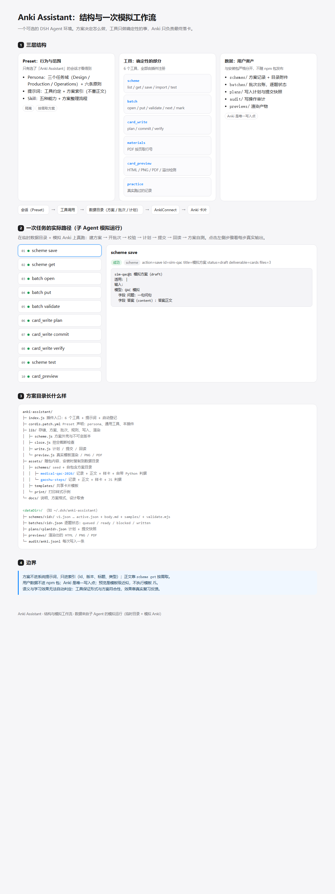

# Anki Assistant

一个**可选的 Agent 环境**（Preset「Anki Assistant」）：用方案驱动做卡，工具只做确定性的事——
存方案、排队、校验、写入、回读、渲染。判断（怎么取原文、怎么拆卡、怎么写记忆提示）由 Agent 与方案决定。

## 名称

| 用途 | 值 |
|---|---|
| npm 包 / 仓库名 | `dsh-anki-assistant` |
| Preset 显示名 | Anki Assistant |
| 插件内部 id | `anki-assistant` |
| 数据目录 | `~/.dsh/anki-assistant` |

## 截图




## 目录

```
anki-assistant/
  index.js               装配：settings / store / anki / boot / 提示词
  cordis.patch.yml       Preset 声明：persona、通用工具、本项目插件
  lib/
    tools/               7 个工具：scheme、project、practice、batch、materials、card_write、card_preview
    store.js             原子 JSON 存储，损坏文件隔离
    scheme.js            方案外壳：校验、不可变版本
    library.js           方案正文、模板、实践库的读写
    batch.js             批次状态机
    rules.js            机械规则（JS）
    validators.js        规则实现：字当量、序号、表格、挖空
    cloze.js             挖空截断检查：BRACE / TAIL / UNCLOSED
    write.js             计划、提交、回读
    anki.js              AnkiConnect 薄客户端 + GUI 动作 + 自动拉起
    materials.js         PDF 按页重建行，返回页与行号
    preview.js           卡面渲染：真实模板 / CSS / MathJax / PNG / PDF
    project.js           项目目录
  assets/                随包：skills/、print/（技能与打印样式，不含方案）
  examples/              仓库示例，不打包
    schemes/             qac-memory、qac-exam、gaoshu-steps、medical-qac-2026（可直接 scheme import）
    practices/           实践示例
    templates/           卡片模板说明（qac-v4.md）
  docs/ locale/ test/ scripts/
```

## 三层数据

| 层 | 位置 | 说明 |
|---|---|---|
| 包内 | `assets/` | 只放运行必需：技能与打印样式；**不含方案** |
| 示例 | `examples/` | 仓库自带，用户 Agent 按需 `scheme import`，不随包 |
| 数据 | `<dataDir>/schemes`、`batches`、`plans`、`audit`、`previews`、`practices`、`sources` | 用户资产与运行记录，**不打包** |
| Anki | AnkiConnect | 最终卡片 |

新装时方案库是空的；示例在仓库 `examples/`，需要时显式导入：

```bash
scheme import path=<repo>/examples/schemes/qac-memory
scheme import path=<repo>/examples/schemes/gaoshu-steps
```

方案保存即新版本；确认不再需要的旧版本用 `scheme prune` 清理。

## 工具

| 工具 | 作用 |
|---|---|
| `project` | 项目：`open` / `list` / `get` / `update` / `close` / `to-scheme` / `delete`（一次任务的现场，跑通后提炼方案） |
| `scheme` | 方案库：`list` / `get` / `save`（永远写新版本） / `derive`（从外部文件起新方案草稿） / `import`（导入外部目录；同名加 `upgrade=true` 出外部来源的新版本） / `test` / `prune`（清理旧版本，保留当前版本及批次、项目钉住的版本） / `delete`（需确认，有批次或项目引用时拒绝） |
| `practice` | 实践库：`list` / `get` / `save`（记录一次真实运行） / `delete`（需确认） |
| `batch` | 批次：`open` / `put` / `validate` / `fix`（修复挖空截断） / `next` / `mark` / `status` |
| `materials` | 读资料并给行号：PDF 按页重建行，可按关键词只取命中行 |
| `card_write` | 写入闸门：`plan`（add/update） / `commit`（幂等，可 `open=true` 在 Anki 打开） / `verify`（按快照回读） / `delete`（需确认，删除前后各读一次） |
| `card_preview` | 渲染预览：`png`、`split`（逐张）、`pdf`（A4）、`measure`（溢出检测） |

## 方案接口

方案是数据记录 + 方案目录里的文件，不是插件代码。完整目录约定与写作顺序见 [docs/SCHEME-FORMAT.md](docs/SCHEME-FORMAT.md)；拿到项目就要干活的话，先读 [docs/AGENT-BRIEF.md](docs/AGENT-BRIEF.md)。

- `scheme.json` 记录 `id`、`status`、`deliverable`、模型、字段和判据。登记时由插件分配 `version`。
- `body.md`、样卡、样式及校验器随版本保存。`scheme get` 返回该版本的正文和附件目录 `assetDir`。
- `samples/pass.json`、`samples/fail.json`：合格样卡与反例
- `validate.mjs`：方案自带校验器，导出 `validate(fields, options) → { suite, ok, issues, source }`；缺模块或异常都明确报错，不退回 JS 兜底
- `print.css`：该方案的打印样式，自动生效
- 方案目录的 `vendor/`：方案私有的原码与依赖（如 `medical-qac-2026` 的 Python 判据）

机械检查包括插件内置规则与方案自带的校验器。外部导入和旧版方案的脚本由用户配置 `trustedSchemeVersions` 后启用，按 `id@version` 授权。

## 质量闸门

1. `batch validate` 与 `card_write plan` 都会跑：方案规则 + 内置 cloze 检查 + 方案校验器；
2. 命中问题写进该题的 `issues`，状态标 `blocked`，`commit` 不会写；
3. 校验器缺失或异常 → 报「旧判据未执行」，不通过；
4. 出处核验需要 refdb，未配置时明确标「出处未核」，不当作失败，也不当作通过；
5. 计划绑定草稿、条目状态、方案版本和目标。可用 `card_preview plan=…` 核对当时计划里的可写条目。
6. `commit` 保留每个条目的回执。连接中断后重试同一个计划，插件会核对已有结果并继续待确认的部分。

## 渲染与打印

`card_preview` 用模型的真实 Front/Back 模板与 CSS 渲染，支持 MathJax：

- `png=true`：整批一张长图，高度随卡数增长；
- `split=true`：每张单独 PNG，便于 `read_image` 逐张看；
- `pdf=true`：A4 打印版，`pdfStyle` 选 `qa` / `question` / `answer`；
- `pdfCss`：自定义 CSS，文件路径或 `assets/print` 下的文件名；方案目录的 `print.css` 自动生效；
- `measure`：量横向溢出，回报「#3 div越界」这类文本，供 Agent 自动修正。

## 依赖

| 依赖 | 需要 | 缺失时 |
|---|---|---|
| Anki + AnkiConnect | 写入、按笔记预览、读取真实模型 | 方案与批次仍可用。方案和批次预览可退回字段渲染 |
| `pdfjs-dist`（可选） | 读 PDF | `.txt` / `.md` 仍可读 |
| Python 3.10+ | 仅声明旧判据的方案（如 `medical-qac-2026`） | 报「旧判据未执行」，不降级 |
| Microsoft Edge | PNG / PDF | 只出 HTML |

## 配置与安装

```yaml
- id: anki-assistant
  name: dsh-anki-assistant
  config:
    dataDir: "C:/Users/you/.dsh/anki-assistant"
    ankiUrl: "http://127.0.0.1:8765"
    ankiExe: "C:/Program Files/Anki/anki.exe"   # 可选；不填则探测常见安装位置
    autoLaunchAnki: true                        # Anki 没开时自动拉起，默认开
    python: "python -X utf8"        # 仅带旧判据的方案用到
    trustedSchemeVersions: []       # 只填已审阅的版本，例如 "gaoshu-steps@1"
```

这段写在 profile 的 preset 配置里（`preset-anki-assistant` 下 `anki-assistant` 那一行的 `config`），或用 GUI 的插件设置改；不配就用默认值。改完重启 Desktop。

外部方案的脚本可在本机执行。用户审阅附件后，把具体版本加入 `trustedSchemeVersions` 并重启。升级成新版本后，按新版本单独授权。

安装后在**新会话**里选 Preset「Anki Assistant」；工具、技能与提示词都挂在 preset 下，其他会话不受影响。

打包：`npm pack` 生成 tarball（含 `lib/`、`assets/`、`docs/`、`scripts/`、`LICENSE`，不含 `test/`、`dist/`、`__pycache__`）。要发布到 npm 需先去掉 `package.json` 里的 `"private": true`。

运行时依赖两个包：`parse5`（预览 HTML 过滤）与 `proper-lockfile`（数据锁）。安装时需要能访问 npm registry；
离线环境请先准备 npm 缓存，或把依赖换成本地 vendored 版本后再装。DSH 用 pnpm 安装时若拿不到 registry，会报拉取依赖失败。

## 测试

```bash
npm test                                   # 根测试：工具、方案、批次、写入、预览、方案入口
node examples/schemes/medical-qac-2026/test/run.mjs   # 方案独立复验
node examples/schemes/medical-qac-2026/test/entry.mjs # 两个入口的真实调用

npm run clean:temp                         # 列出本项目在 %TEMP% 留下的沙箱目录
npm run clean:temp -- --apply --older-than=24       # 删除 24 小时前的
```

测试与模拟脚本会在退出时清掉自建的临时目录；历史残留用 `clean:temp` 处理，只匹配 `anki-*`、`HeadlessEdge*`、`sim-*`。

## 代码结构

```
index.js            装配：settings / store / anki / boot / skill / 提示词，只接线
lib/tools/          7 个工具：scheme、project、practice、batch、materials、card_write、card_preview
lib/                领域层：scheme、batch、write、preview、anki、materials、store、library、project
assets/             随包：skills/、print/
examples/           仓库示例，不打包：schemes/、practices/、templates/
docs/               执行手册、方案格式、设计取舍、迁移
scripts/            体检与清理脚本（不参与运行时）
test/               根测试；方案自带测试在各自目录
```

## 相关工作

- [执行 Agent 手册](docs/AGENT-BRIEF.md)：开工检查、工具契约、批次状态机、失败手册、并发约定
- [方案格式](docs/SCHEME-FORMAT.md)：目录结构、七条不变量、写作顺序、分享方式
- [设计取舍](docs/DETAIL.md)：为什么这样分层、为什么判据归方案
- [贡献指南](CONTRIBUTING.md)｜[变更记录](CHANGELOG.md)

## 边界

- 不实现语义判据（「答案是否忠于原文」由人或方案负责）；
- 不把用户数据打进 npm 包；
- 预览保留常用卡面格式，并限制脚本、外部媒体和本地文件访问。启用 MathJax 时从 CDN 加载排版资源。
